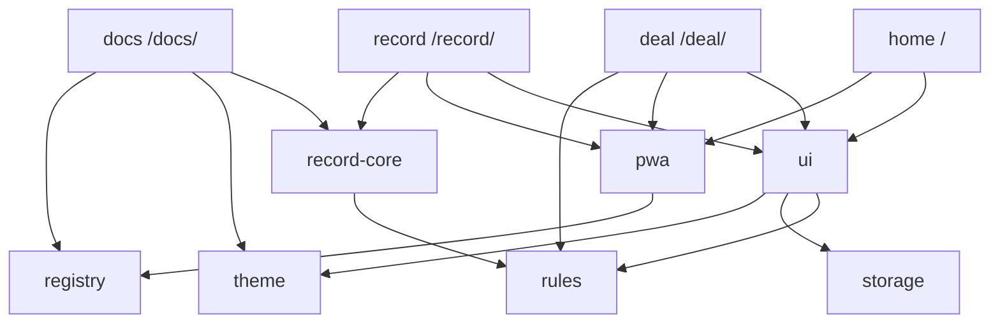

# 架構

這一頁說明 monorepo 裡有哪些 app 與套件、各自負責什麼，以及它們之間的相依關係。

## 一個網站、多個 App

網站由多個獨立建置的 app 組成，各自部署在自己的路徑。每個工具都是可以單獨安裝的 PWA；使用說明（本網站）是一般的靜態網站。

<ToolTable />

這張表直接讀取 `packages/registry/src/tools.ts`。即將推出的工具沒有 app，不會建置。

## 相依關係

上排是 app（及其路徑），下排是 `packages/` 裡的套件（名稱省略 `@avalon/`）。圖中省略了部分邊（例如每個 app 都會用到 `registry`、`storage`、`theme`）；完整的相依以各 `package.json` 為準。

## Apps

| 路徑          | 職責                                                                 |
| ------------- | -------------------------------------------------------------------- |
| `apps/home`   | 工具清單、資訊頁（版本、空間用量、更新紀錄）、1.x 舊網址導向、404 頁 |
| `apps/record` | 遊戲紀錄：開局、派票、任務、湖中女神、結算、匯出入、分享             |
| `apps/deal`   | 角色發牌：發角色、出任務、湖中女神、歷史紀錄                         |
| `apps/docs`   | 使用說明（VitePress），沒有 manifest 與 service worker               |

## Packages

| 套件                                       | 職責                                                                       |
| ------------------------------------------ | -------------------------------------------------------------------------- |
| `@avalon/rules`（`packages/avalon-rules`） | 純 TS 的阿瓦隆規則：人數、出隊、陣營、角色、視野                           |
| `@avalon/record-core`                      | 純 TS 的遊戲紀錄：型別、reducer、`deriveState`、zod schema、匯出、分享格式 |
| `@avalon/registry`                         | 工具清單，build、dev、PWA、首頁都由它產生                                  |
| `@avalon/storage`                          | localStorage 命名空間與版本化讀寫、IndexedDB 名稱                          |
| `@avalon/theme`                            | Catppuccin 色票 → CSS token、防閃爍腳本                                    |
| `@avalon/pass-play`                        | 傳手機流程：洗牌、發角色／出任務／湖中女神狀態機、角色設定與卡片文字       |
| `@avalon/ui`                               | 共用 React 元件（AppShell、Sheet、主題選擇、更新提示、空間用量）、全站主題 |
| `@avalon/pwa`                              | `createPwaConfig`、service worker 快取清理、圖示產生、版本字串             |
| `@avalon/licenses`                         | 建置時產生第三方授權聲明（`licenses.txt`），擋下不允許的授權               |
| `@avalon/tsconfig`                         | 共用 tsconfig                                                              |

## 邊界規則

`pnpm lint` 會執行 `scripts/check-boundaries.ts`：

- app 之間不能互相 import（不論用套件名稱或相對路徑）；共用的程式放 packages。
- packages 不能 import app。
- 純套件（`avalon-rules`、`record-core`）不能依賴 React、DOM、圖示或資料庫套件。

使用說明的規則表格因此只從 `@avalon/rules` 取資料；角色發牌自己的預設配置在 `apps/deal` 裡，文件只能手寫。
